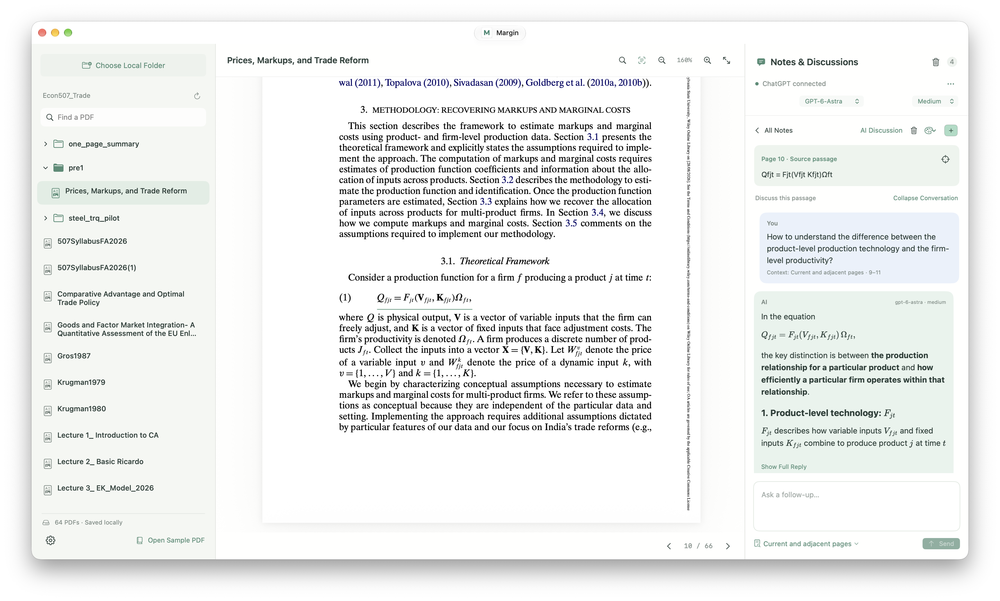
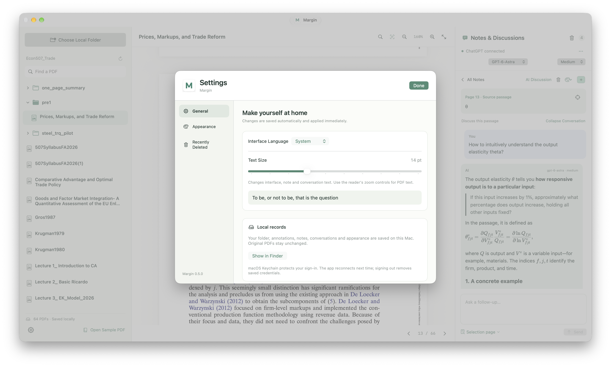
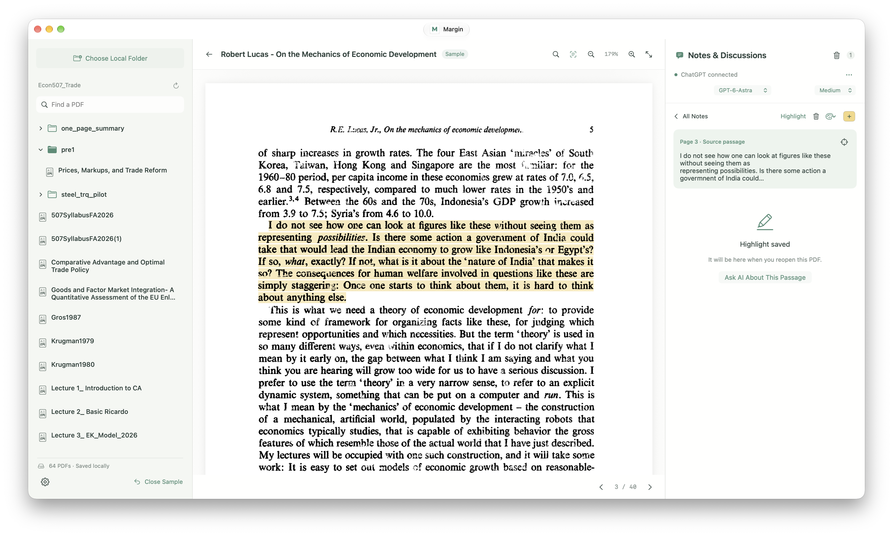

# Margin

[English](#english) | [简体中文](#简体中文)

**v0.5.0 · macOS 14+ · Apple Silicon**

## Preview · 界面预览

**1. AI conversations beside the source · 在原文旁展开 AI 讨论**



**2. Language and text-size settings · 调整界面语言与字体大小**



**3. Highlight and save a passage · 高亮并保存经典段落**



## English

A local PDF reader for macOS that keeps highlights, notes, and AI conversations beside the passages they refer to.

[Download Margin 0.5.0](https://github.com/Rosie1898/Margin/releases/download/v0.5.0/Margin-0.5.0-macOS-arm64.zip) · [Release notes](https://github.com/Rosie1898/Margin/releases/tag/v0.5.0)

### Features

- **Folder structure preserved**: browse and search PDFs within their local subfolders, then return to your last document and reading position.
- **Notes beside the source**: select text to reveal a nearby toolbar for highlighting, commenting, or asking AI. Click a note in the sidebar to return to its passage. Conversations support follow-up questions and folding long discussions.
- **Stable reading position**: jumping to a comment scrolls vertically while preserving your horizontal position when zoomed in.
- **Search within PDFs**: use `⌘F` to find text and `⌘G` / `⌘⇧G` to move to the next or previous match. Search covers existing text layers and pages with completed OCR.
- **Selectable AI context**: each question can use just the selection, its page, the current and adjacent pages, custom pages, or the entire document. The conversation keeps its history.
- **Math rendering**: Markdown and KaTeX formulas in AI replies render locally, with bundled scripts and fonts available offline. Previously saved replies also use the new rendering.
- **On-device OCR**: scanned pages are recognized automatically with Apple Vision, with an option to process the entire PDF. Results stay on your Mac, do not consume ChatGPT usage, and leave the original PDF unchanged.
- **ChatGPT account connection**: sign in through your browser and choose from the models and reasoning levels returned for your account. Renewal credentials are stored in macOS Keychain, and the app attempts to restore sign-in on its next launch.
- **Recoverable deletion**: undo within 5 seconds or restore items from Recently Deleted in Settings. This version has no recovery deadline and does not automatically erase deleted items permanently.
- **Adjustable three-pane layout**: the initial proportions are **1:3:1**; drag the dividers to adjust them, and your layout is saved automatically.
- **Customizable appearance**: adjust highlight, conversation, and theme colors, background images, pane opacity, and interface font size.
- **Nine interface languages**: Simplified Chinese, Traditional Chinese, English, Japanese, Korean, French, German, Spanish, and Portuguese. The interface follows the system language by default.

### Installation and use

Download the ZIP above, unzip it, move `Margin.app` into Applications, and open it. The application includes Node.js; no separate runtime installation is required.

This build is **ad-hoc signed, without a Developer ID distribution signature or Apple notarization**. If macOS blocks the first launch, confirm the download source, then go to **System Settings → Privacy & Security → Open Anyway** and follow the confirmation prompts. See [Apple’s instructions](https://support.apple.com/en-us/102445).

1. Click **Choose local folder** and select your PDF directory. Click a folder to expand it or a PDF to open it. Refresh the list after adding or moving files.
2. Select text and use **Highlight**, **Comment**, or **Ask AI** beside the selection. On a scanned page, wait for local OCR to finish and then use the same controls. The text recognition menu in the title bar can process the entire PDF or cancel a task.
3. To use AI, click **Sign in** in the right sidebar, complete sign-in and authorization on the OpenAI page, then choose a model and reasoning level and send your question. Choose the context range below the input field; you can change it for follow-ups. Each message includes the selection and keeps the conversation’s history. Available models depend on the account’s returned catalog.
4. Click a note card or quoted passage to return to the source. The gear in the lower-left corner opens Settings; deleted items can be restored from Recently Deleted.

The reading area supports **20%–600%** zoom. Click **Fit to window** to restore automatic sizing. Drag the pane dividers to adjust the layout.

For custom pages, enter a range such as `1-3, 5`, using the PDF page numbers shown at the bottom of the reader. Each turn accepts up to **200 pages and 100,000 characters (counted in UTF-16)**. If the text is too long, choose fewer pages. If a selected page has no text, run local OCR or choose another range. Changing the range changes the pages attached to the current turn; previously supplied material remains in the conversation history.

| Action | Shortcut |
| --- | --- |
| Choose a folder | `⌘⇧O` |
| Highlight selected text | `⌘⇧H` |
| Comment on selected text | `⌘⇧M` |
| Ask AI | `⌘K` |
| Search PDF text | `⌘F` |
| Next match | `⌘G` |
| Previous match | `⌘⇧G` |
| Settings | `⌘,` |

#### Sample document

The sample is Robert E. Lucas, Jr.’s *On the Mechanics of Economic Development* (1988). **The public source repository and downloadable application do not include the paper’s PDF.** The first time you click **Open sample**, the app asks whether to download the original file from its [Stanford-hosted source](https://web.stanford.edu/~klenow/Lucas_Mechanics.pdf). Afterward, it opens offline from the local cache. Source and checksum information is recorded in [Lucas-SOURCE.json](assets/Lucas-SOURCE.json). Rights in the paper remain with their respective holders.

The sample opens at a highlighted classic passage. Your current folder stays in place, and leaving the sample returns you to the previous document and page. If you delete the preset highlight, it is not recreated automatically. Normal reading and on-device OCR do not depend on downloading the sample.

### Data and accounts

Reading, highlighting, commenting, searching, OCR, and math rendering take place locally, without rewriting the original PDF. **OCR does not send pages to a server or consume ChatGPT usage.** When you choose to send an AI question, the filename, selected text, text from your chosen context pages, and that conversation’s history are sent to OpenAI and use the connected account normally. Background images are not sent with questions.

Renewal credentials are stored in macOS Keychain; access tokens remain in memory only. Signing out clears the saved credentials. You will need to sign in again if authorization is revoked or renewal fails. The app does not read sign-in data from other applications.

Reading history, settings, annotations, OCR caches, and complete conversations are stored in:

```text
~/Library/Application Support/LeafReader/
```

`LeafReader` is the retained internal data directory name. Open it in Finder from **Settings → General**. To make a backup, quit the app, copy the entire directory, and keep the original PDFs separately. PDFs with identical content are identified by a content hash, so renaming or copying a file retains its annotations. Changing the file’s contents makes it a separate document. Unsent input drafts are not saved between sessions.

### Current limitations

- OCR works best with printed text. Blurry scans, multiple columns, handwriting, vertical text, and mathematical formulas may be recognized incorrectly. Pages with an existing text layer are skipped; low-quality existing text layers are not repaired. See the [local OCR guide](OCR.md).
- The reader interface does not yet support screenshot or image questions.
- Annotation export, writing annotations into the original PDF, importing annotations from other readers, cross-device synchronization, and password-locked PDFs are not supported.
- Intel Macs have not been adapted or validated.

### Build from source

The native interface uses **SwiftUI, AppKit, PDFKit, Vision, and CoreText**. The account and conversation service uses **Node.js built-in modules** and listens only on a temporary port at `127.0.0.1`.

You need an Apple Silicon Mac, Xcode Command Line Tools providing `swiftc` and a macOS 14+ SDK, and an arm64 build of Node.js 22 or later.

```sh
git clone https://github.com/Rosie1898/Margin.git
cd Margin
bash scripts/build.sh
open Margin.app
```

The script creates `Margin.app` and applies an ad-hoc signature. It uses Node from `PATH` by default; set `NODE_BINARY` to the absolute path of a Node executable to use another copy. If your Node version differs from the version recorded in this repository, provide that version’s complete license file through `NODE_LICENSE_FILE`. See [third-party notices](THIRD_PARTY_NOTICES.md).

Run the checks:

```sh
node --test Backend/*.test.mjs
bash scripts/test-native.sh
bash scripts/test-ocr.sh
bash scripts/test-math.sh
```

Backend checks use mocked responses and do not call live models. Native checks cover local data, the PDF canvas and search, AI context ranges, service lifecycle, Keychain, localization, pane layout, folder structure, and sample navigation. OCR checks use synthetic scanned pages to cover actual on-device recognition, text selection, coordinates, caching, annotations, and cancellation. Math checks verify Markdown and formula rendering in the application’s WebKit view. Run these native checks in a macOS desktop session for Keychain, Vision, and WebKit access. Add `--build-only` to the OCR or math check command to compile without running it.

During development, set `LEAF_DATA_DIR` to a separate absolute path to keep test data separate from your everyday reading records.

[Backend API](Backend/README.md) · [Changelog](CHANGELOG.md) · [0.5.0 release notes](RELEASE_NOTES.md) · [Font-size samples and literary sources](FONT_SAMPLES.md) · [Third-party notices](THIRD_PARTY_NOTICES.md)

---

## 简体中文

一个面向 macOS 的本地 PDF 阅读器，把高亮、评论和 AI 讨论留在原文旁边。

[下载 Margin 0.5.0](https://github.com/Rosie1898/Margin/releases/download/v0.5.0/Margin-0.5.0-macOS-arm64.zip) · [发布说明](https://github.com/Rosie1898/Margin/releases/tag/v0.5.0)

### 功能

- **保留文件夹结构**：按本地子文件夹浏览和搜索 PDF，记住上次打开的文件与阅读页码。
- **在原文旁做笔记**：拖选文字后，选区附近出现高亮、评论和问 AI 工具条；点击右侧笔记可定位原文。支持连续追问和长讨论折叠。
- **保持阅读位置**：点击评论跳转时只调整上下位置，保留放大后的横向位置。
- **文内搜索**：`⌘F` 查找关键词，`⌘G` / `⌘⇧G` 跳到下一处或上一处；可搜索原有文字层和已完成 OCR 的页面。
- **可选 AI 参考范围**：每次提问可选择仅选中文字、划线所在页、前后各一页、指定页码或整份文档；同一条讨论保留历史。
- **公式排版**：AI 回复中的 Markdown 和 KaTeX 数学公式在本机显示；脚本、字体均随应用提供，可离线排版，已保存的回复也会使用新排版。
- **本地 OCR**：扫描页自动使用 Apple Vision 识别，也可处理整份 PDF。识别结果保存在本机，不消耗 ChatGPT 用量，不改写原 PDF。
- **ChatGPT 账号连接**：通过浏览器登录授权，选择账号返回的模型与推理强度；macOS 钥匙串保存续期凭据，下次启动自动尝试恢复登录。
- **可恢复的删除**：删除后有 5 秒撤销提示，也可在设置中的“最近删除”恢复；本版没有恢复截止日，不会自动永久清除。
- **可调整的三栏布局**：首次打开按 **1:3:1** 分配宽度；拖动调整后自动保存。
- **清淡的自定义外观**：调整高亮、气泡、主题颜色、背景图片、区域不透明度和界面字号。
- **九种界面语言**：简体中文、繁体中文、英语、日语、韩语、法语、德语、西班牙语、葡萄牙语；默认跟随系统。

### 安装与使用

下载上方 ZIP，解压后将 `Margin.app` 放入“应用程序”并打开。成品包含 Node.js 运行时，无需另行安装。

当前构建使用 **ad-hoc 签名，未进行 Developer ID 分发签名或 Apple 公证**。首次打开如被 macOS 拦截，确认下载来源后，进入“系统设置 → 隐私与安全性”，点击“仍要打开”，再按提示确认。具体步骤见 [Apple 说明](https://support.apple.com/en-us/102445)。

1. 点击“选择本地文件夹”，选择 PDF 目录。点击文件夹展开，点击 PDF 打开；新增或移动文件后可刷新列表。
2. 拖选正文，使用选区附近的“高亮”“评论”或“问 AI”。扫描页先等待本地 OCR 完成，再使用相同操作；标题栏文字识别菜单可处理整份 PDF 或取消任务。
3. 使用 AI 时，点击右侧“登录”，在 OpenAI 页面完成登录授权，再选择模型、推理强度并提问。输入框下方可选择参考范围，追问时也能更改；每次发送都会附加选中文字并保留本条讨论历史。可用模型取决于账号返回的目录。
4. 点击笔记卡片或引用内容返回原文。左下角齿轮进入设置；误删内容可在“最近删除”恢复。

阅读区支持 **20%–600%** 缩放，点击“适合窗口”恢复自动适应。三栏分隔线可以直接拖动。

指定页码时，可输入 `1-3, 5`，页码以阅读区底部显示的 PDF 页序为准。每轮参考最多 **200 页、100,000 字符（UTF-16 计数）**；文字过多时会提示缩小范围。范围内有页面缺少文字时，先运行本地 OCR 或改选其他页面。更改范围会调整本轮附加的页面，之前发送的资料仍保留在讨论历史中。

| 操作 | 快捷键 |
| --- | --- |
| 选择文件夹 | `⌘⇧O` |
| 高亮选中文字 | `⌘⇧H` |
| 评论选中文字 | `⌘⇧M` |
| 向 AI 提问 | `⌘K` |
| 搜索 PDF 正文 | `⌘F` |
| 下一处匹配 | `⌘G` |
| 上一处匹配 | `⌘⇧G` |
| 设置 | `⌘,` |

#### 入门示例

示例采用 Robert E. Lucas, Jr. 的 *On the Mechanics of Economic Development*（1988）。**公开源码和下载应用不包含论文 PDF**；首次点击“打开入门示例”时，会询问是否从 [Stanford 托管地址](https://web.stanford.edu/~klenow/Lucas_Mechanics.pdf)下载原文件，之后可从本机缓存离线打开。文件来源与校验信息见 [Lucas-SOURCE.json](assets/Lucas-SOURCE.json)。论文权利仍归原权利人。

示例会定位到经典段落的预置高亮。打开示例会保留当前文件夹，退出后返回先前的文档与页码；删除预置高亮后不会自动重新生成。普通阅读和本地 OCR 均不依赖示例下载。

### 数据与账号

普通阅读、高亮、评论、搜索、OCR 和公式排版在本机完成，原始 PDF 不会被改写。**OCR 不发送页面到服务器，也不消耗 ChatGPT 用量**。主动发送 AI 问题时，会将文件名、所选文字、所选参考范围的页面文字及该条讨论的历史发送给 OpenAI，并正常使用连接账号的用量；背景图片不随问题发送。

登录续期凭据由 macOS 钥匙串保存，访问令牌只保存在内存中。退出登录会清除保存的凭据；授权撤销或续期失效后需要重新登录。应用不读取其他应用的登录状态。

阅读记录、设置、标注、OCR 缓存和完整讨论保存在：

```text
~/Library/Application Support/LeafReader/
```

`LeafReader` 是沿用的内部数据目录名，可从“设置 → 通用”在 Finder 中打开。备份前请退出应用，再复制整个目录，并单独保留原始 PDF。内容完全相同的 PDF 通过内容哈希识别，改名或复制后可继续使用同一组标注；修改文件内容后会视为另一份文档。尚未发送的输入草稿不会持久保存。

### 当前限制

- OCR 适合印刷体；模糊扫描、多栏、手写、竖排和数学公式可能识别不准。已有文字层的页会跳过，不会修复质量不佳的旧文字层。详见 [本地 OCR](OCR.md)。
- 阅读器界面暂不支持截图或图片提问。
- 暂不支持标注导出、写回原 PDF、导入其他阅读器的标注、跨设备同步或密码锁定的 PDF。
- Intel Mac 尚未适配验证。

### 从源码构建

原生界面使用 **SwiftUI、AppKit、PDFKit、Vision 和 CoreText**；账号与讨论服务使用 **Node.js 内置模块**，只监听本机 `127.0.0.1` 的临时端口。

需要 Apple Silicon Mac、提供 `swiftc` 和 macOS 14+ SDK 的 Xcode Command Line Tools，以及 arm64 版 Node.js 22+。

```sh
git clone https://github.com/Rosie1898/Margin.git
cd Margin
bash scripts/build.sh
open Margin.app
```

脚本生成 `Margin.app` 并进行 ad-hoc 临时签名。默认使用 `PATH` 中的 Node；也可用 `NODE_BINARY` 指定 Node 可执行文件的绝对路径。若使用的 Node 版本与仓库记录不同，请通过 `NODE_LICENSE_FILE` 提供对应版本的完整许可文件，参见 [第三方声明](THIRD_PARTY_NOTICES.md)。

运行检查：

```sh
node --test Backend/*.test.mjs
bash scripts/test-native.sh
bash scripts/test-ocr.sh
bash scripts/test-math.sh
```

后端检查使用模拟响应，不调用真实模型。原生检查覆盖本地数据、PDF 画布与搜索、AI 参考范围、服务生命周期、钥匙串、多语言、分栏布局、目录树和示例导航。OCR 检查使用合成扫描页，覆盖真实本地识别、文字选择、坐标、缓存、标注和取消；公式检查验证应用内 WebKit 的 Markdown 与数学排版。请在 macOS 桌面会话中运行这些原生检查，以访问钥匙串、Vision 和 WebKit。OCR 与公式检查可用 `--build-only` 只编译。

开发时可设置 `LEAF_DATA_DIR` 为独立的绝对路径，避免使用日常阅读记录。

[后端接口](Backend/README.md) · [版本变化](CHANGELOG.md) · [0.5.0 发布说明](RELEASE_NOTES.md) · [字号示例与文学出处](FONT_SAMPLES.md) · [第三方声明](THIRD_PARTY_NOTICES.md)
